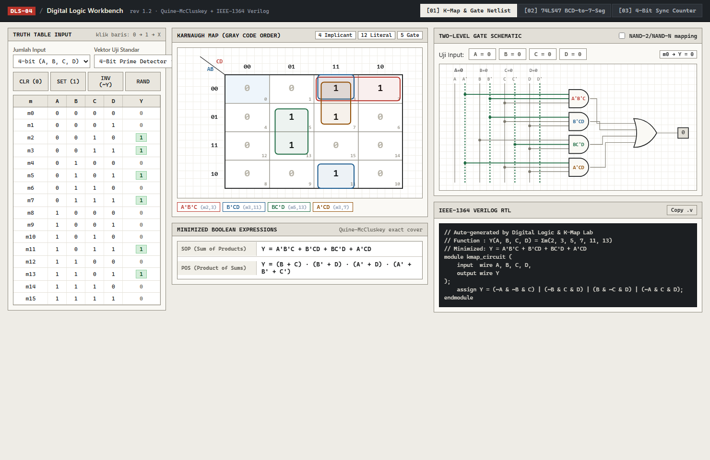
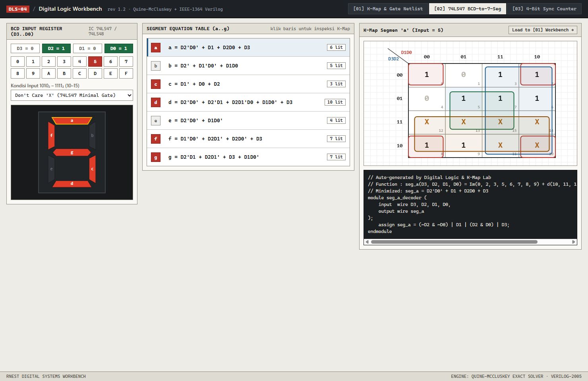
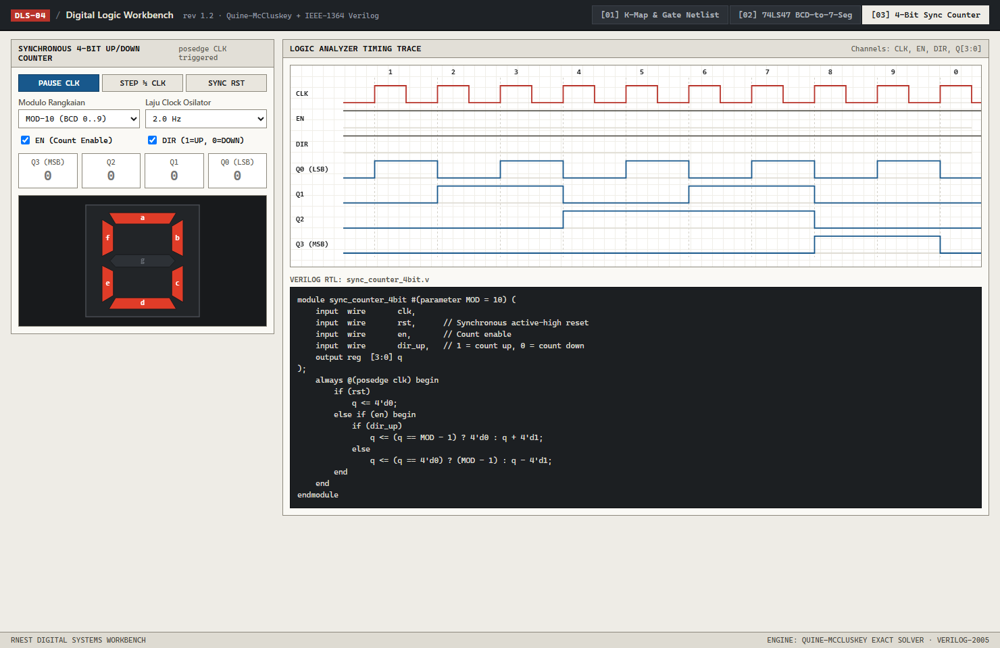
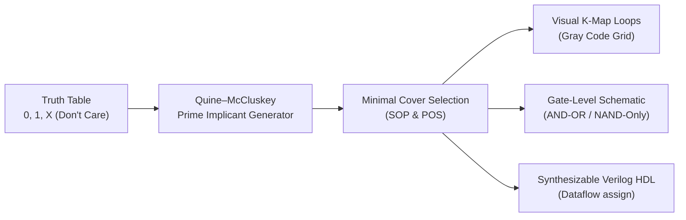

# Digital Logic, Karnaugh Map (K-Map) Solver & Verilog HDL Studio

> ** Link Akses:** **[https://shofwanraditya.github.io/digital-logic-lab/](https://shofwanraditya.github.io/digital-logic-lab/simulator/)**
>
> **Interactive Digital Systems Laboratory** — menggabungkan penyederhanaan Aljabar Boolean (**Quine–McCluskey & Karnaugh Map 2–4 Variabel**), simulasi skema gerbang logika **AND-OR / NAND-Only**, **BCD-to-7-Segment Decoder (`a–g`)**, **4-Bit Synchronous Up/Down Counter** dengan *Logic Analyzer Timing Diagram*, serta **Generator & Testbench Verilog HDL**.

---

## 📸 Preview Laboratorium

| 1. K-Map Solver & Gate Schematic | 2. BCD-to-7-Segment Decoder (`a–g`) | 3. Synchronous Counter & Timing Analyzer |
| :---: | :---: | :---: |
|  |  |  |

---

## Fitur Utama

### 1. Karnaugh Map (K-Map) Solver & Gate-Level Schematic (Tab 1)
* **2, 3, dan 4 Variabel (`A, B, C, D`):** Klik langsung baris pada **Tabel Kebenaran (Truth Table)** atau sel pada **Peta Karnaugh** untuk mengubah output antara `0`, `1`, dan `X` (*Don't Care*).
* **Exact Quine–McCluskey + Essential Prime Implicant Cover:** Menemukan solusi **SOP (Sum of Products)** dan **POS (Product of Sums)** dengan jumlah literal paling minimal, lengkap dengan visualisasi loop kelompok warna-warni pada K-Map (termasuk *wrap-around* tepi & 4 pojok).
* **Interactive Gate Schematic (AND-OR & NAND-Only):** Menggambar rangkaian gerbang logika secara otomatis beserta simulasi tegangan tinggi/rendah (`0`/`1`) ketika sakelar input diuji.
* **Synthesizable Verilog HDL Generator:** Menghasilkan modul Verilog `assign` secara *real-time* yang siap disalin ke Vivado, Quartus, atau Icarus Verilog.

### 2. BCD-to-7-Segment Decoder Lab (Tab 2)
* **Eksperimen Don't Care (`1010₂ – 1111₂`):** Bandingkan penghematan jumlah gerbang logika saat input `10–15` diperlakukan sebagai *Don't Care (`X`)* (standar IC dekoder 74LS47/74LS48) dibandingkan mode *Hexadecimal (`A–F`)* atau *Blank (`0`)*.
* **Inspeksi K-Map per Segmen (`a–g`):** Klik salah satu dari 7 persamaan segmen untuk melihat peta Karnaugh dan modul Verilog masing-masing segmen, atau buka langsung di K-Map Studio.

### 3. Synchronous 4-Bit Up/Down Counter & Logic Analyzer (Tab 3)
* **Simulasi Rangkaian Sekuensial:** Memodelkan **Synchronous Counter** berbasis Flip-Flop dengan sinyal kontrol `CLK`, `RST` (synchronous reset), `EN` (enable), dan `DIR` (Up/Down), serta pilihan **Modulo-10 (BCD Decade Counter)** atau **Modulo-16 (4-Bit Binary)**.
* **Real-Time Timing Waveform Diagram:** Menampilkan gelombang digital `CLK`, `EN`, `DIR`, dan `Q0..Q3` secara sinkron tepat pada *rising edge* ($\uparrow$) sinyal `CLK`.

---

##Arsitektur & Alur Sintesis Logika Digital



### Persamaan K-Map BCD-to-7-Segment (Mode Don't Care `10–15 = X`)
Dengan input BCD $\text{D3 D2 D1 D0}$, ketujuh segmen dapat direduksi menjadi:
* $a = \overline{\text{D2}}\,\overline{\text{D0}} + \text{D1} + \text{D2}\,\text{D0} + \text{D3}$
* $b = \overline{\text{D2}} + \overline{\text{D1}}\,\overline{\text{D0}} + \text{D1}\,\text{D0}$
* $c = \overline{\text{D1}} + \text{D0} + \text{D2}$
* $d = \overline{\text{D2}}\,\overline{\text{D0}} + \overline{\text{D2}}\,\text{D1} + \text{D2}\,\overline{\text{D1}}\,\text{D0} + \text{D1}\,\overline{\text{D0}} + \text{D3}$
* $e = \overline{\text{D2}}\,\overline{\text{D0}} + \text{D1}\,\overline{\text{D0}}$
* $f = \overline{\text{D1}}\,\overline{\text{D0}} + \text{D2}\,\overline{\text{D1}} + \text{D2}\,\overline{\text{D0}} + \text{D3}$
* $g = \overline{\text{D2}}\,\text{D1} + \text{D2}\,\overline{\text{D1}} + \text{D3} + \text{D1}\,\overline{\text{D0}}$

---

##Struktur Repositori

```text
digital-logic-lab/
├── simulator/                       # Web-based Interactive Digital Logic Studio
│   ├── index.html                   # Antarmuka 3-Tab (K-Map, 7-Segment, Counter)
│   ├── css/style.css                # Tema gelap laboratorium sistem digital
│   └── js/
│       ├── core/
│       │   ├── qm.js                # Algoritma Quine–McCluskey, K-Map & Verilog generator
│       │   └── sevenSeg.js          # Model BCD-to-7-Segment & Synchronous 4-Bit Counter
│       ├── ui/renderers.js          # Renderer Canvas 2D: K-Map, Gate Schematic, 7-Seg, Timing
│       └── app.js                   # Kontroler interaktif & state management
├── verilog/                         # Modul Hardware Description Language (IEEE 1364 Verilog)
│   ├── src/
│   │   ├── bcd_to_7seg.v            # Decoder BCD ke 7-Segment hasil minimisasi K-Map
│   │   ├── sync_counter_4bit.v      # 4-Bit Synchronous Up/Down Counter (parameterized MOD)
│   │   └── prime_detector_4bit.v    # Detektor bilangan prima 4-bit (kombinasional)
│   └── tb/
│       └── tb_digital_lab.v         # Self-checking testbench untuk Icarus Verilog
├── tests/
│   └── run-tests.js                 # Unit test algoritma Boolean, 7-Seg, & Counter
└── .github/workflows/ci.yml         # Automated CI: Node.js + Icarus Verilog (iverilog)
```

---

##Cara Menjalankan

### 1. Menjalankan Simulator Web
Tidak memerlukan instalasi *package* apa pun:
* Buka file [`simulator/index.html`](simulator/index.html) langsung di browser, atau akses melalui **GitHub Pages**.

### 2. Menjalankan Unit Test & Simulasi Verilog HDL
```bash
# 1. Jalankan unit test JavaScript (Quine-McCluskey, 200 random truth tables, 7-Seg, Counter)
node tests/run-tests.js

# 2. Jalankan simulasi hardware Verilog menggunakan Icarus Verilog (iverilog)
iverilog -g2012 -o sim.vvp verilog/src/*.v verilog/tb/tb_digital_lab.v
vvp sim.vvp
```

---

## Lisensi

Didistribusikan di bawah lisensi **MIT**.
